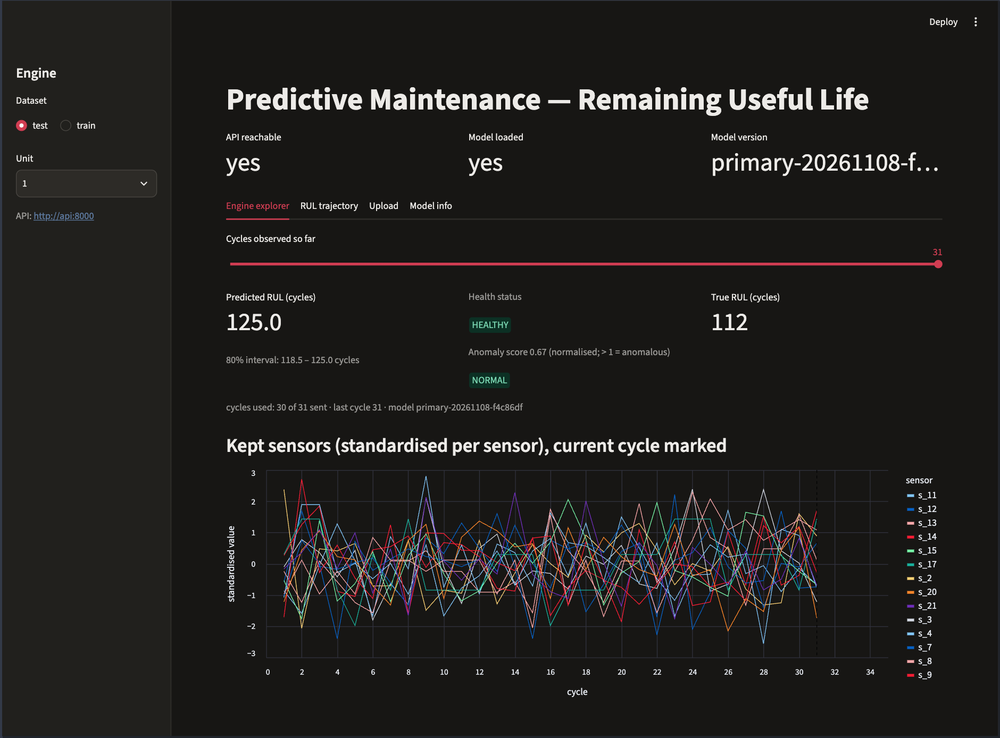
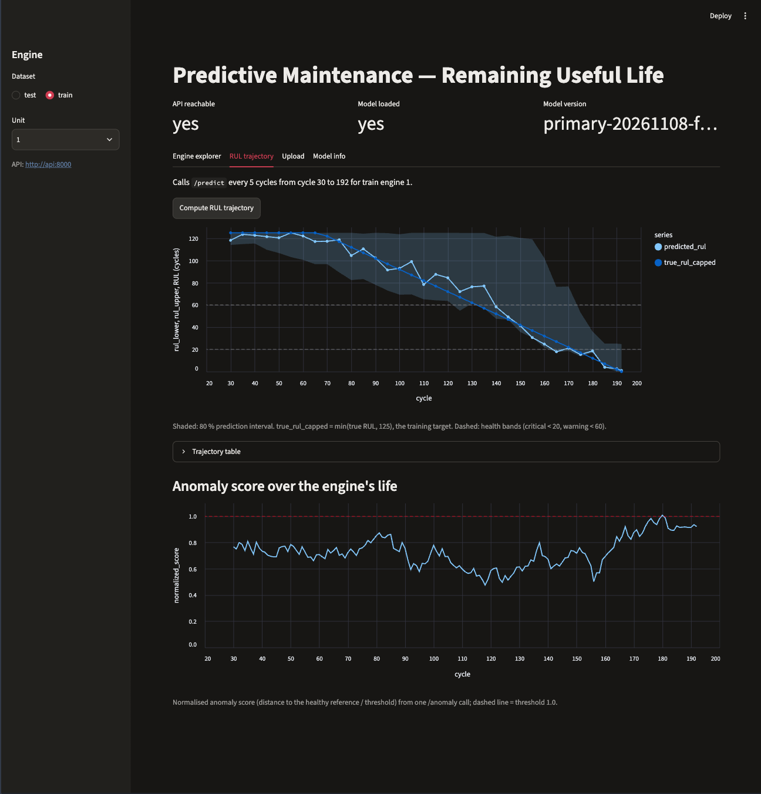
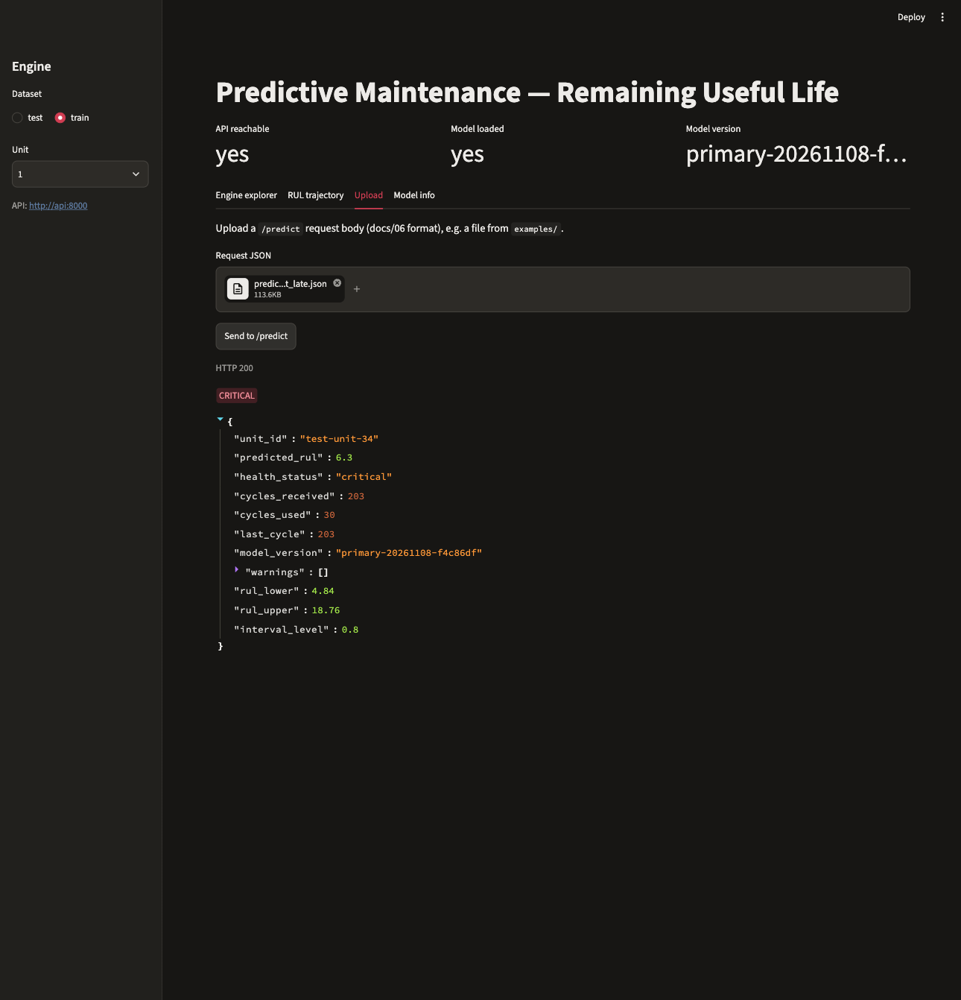
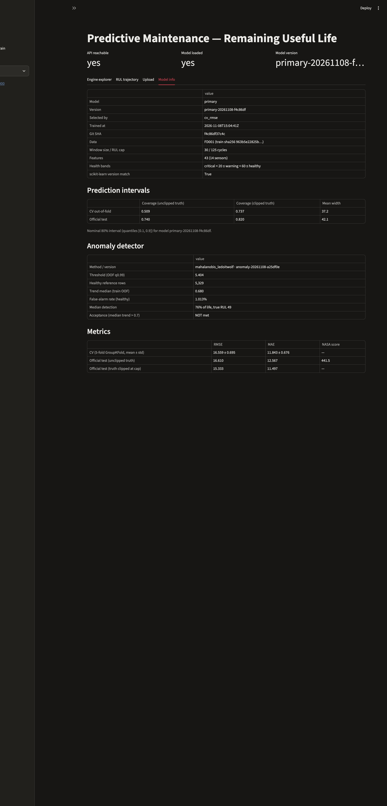
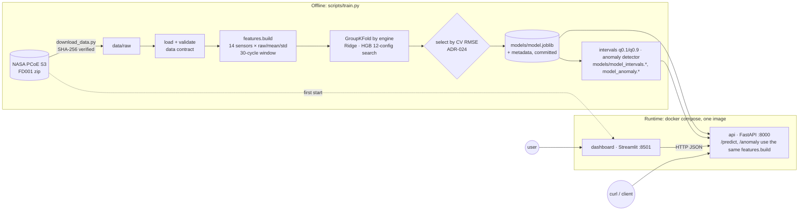

# Industrial AI — Predictive Maintenance Platform

End-to-end remaining-useful-life (RUL) prediction for turbofan engines on NASA's C-MAPSS **FD001** benchmark: reproducible data acquisition, leakage-safe features, engine-grouped cross-validation, two models with a pre-registered selection rule, a FastAPI service, a Streamlit dashboard, Docker Compose and CI. On the official test set (100 engines, unclipped truth) the served **HistGradientBoosting** model reaches **RMSE 16.61 / MAE 12.57 cycles**, against **RMSE 19.14 / MAE 15.35** for the Ridge baseline. It was selected on 5-fold CV RMSE (16.56 vs 19.15), not on the test set. Since Milestone 8 each prediction also carries a nominal 80 % quantile-regression interval. Since Milestone 10 that interval is conformally calibrated on held-out engines, reaching 77.7 % coverage against the capped target (pre-registered band 77–83 %; see Results). Milestone 9 adds a minimal unsupervised anomaly score (`POST /anomaly`): it is implemented and evaluated without labels, but it **did not meet its own trend target**. Milestone 11 tested one pre-registered remedy (smoothing). It did not meet the target and made detection worse, so it was rejected and the raw score is served (see Results).

[](https://github.com/Rakibul-cyber/industrial-ai-predictive-maintenance/actions/workflows/ci.yml)

## Screenshots






## Quickstart

Both options were verified from a fresh clone of this repository (Milestone 7).

### Option A: Docker (recommended)

Requires Docker with Compose v2. The served model is committed, so no training is needed. The first start downloads FD001 (~12 MB) into `./data`; later starts work offline.

```bash
git clone https://github.com/Rakibul-cyber/industrial-ai-predictive-maintenance.git
cd industrial-ai-predictive-maintenance
export APP_UID=$(id -u) APP_GID=$(id -g)   # Linux: lets the dashboard write to ./data (harmless on macOS)
docker compose up -d --build               # API on http://localhost:8000, dashboard on http://localhost:8501
docker compose ps                          # wait until both show "(healthy)"
curl -s -X POST localhost:8000/predict -H "Content-Type: application/json" -d @examples/predict_request_late.json
docker compose down
```

`bash scripts/smoke_test.sh` builds, starts, checks and tears down the stack in one go; CI runs it on every push. Details: [docs/10_DEPLOYMENT_PLAN.md](docs/10_DEPLOYMENT_PLAN.md).

### Option B: local Python

Requires Python 3.13 (`python3`) and network access to NASA's S3 bucket.

```bash
python3 -m venv .venv && source .venv/bin/activate
pip install -r requirements-dev.txt && pip install -e .
python scripts/download_data.py      # downloads ~12 MB, verifies SHA-256, extracts to data/raw/CMAPSSData/
python -m predmaint.data.validate    # checks the FD001 data contract (docs/04 §6)
ruff check . && ruff format --check .
pytest -q                            # includes the 85 % coverage gate; real-data tests run when data/raw/ is present
python -m predmaint.api.main         # API on http://127.0.0.1:8000 (docs at /docs), serving the committed model
streamlit run src/predmaint/dashboard/app.py --server.address localhost --server.port 8501   # second terminal
```

**Retrain (optional).** Reproduces the committed model (verified byte-identical from a fresh clone):

```bash
python scripts/train.py --model baseline   # Ridge: CV + official test metrics → models/, reports/
python scripts/train.py --model primary    # HistGradientBoosting: 12-config CV search (~80 s on 8 cores)
python scripts/train.py --select           # promote the lower-CV-RMSE model → models/model.joblib, model_metadata.json
python scripts/train.py --model intervals  # q0.1/q0.9 interval models for the served model → models/model_intervals.*
python scripts/train.py --model anomaly    # anomaly detector for the served model (~2 s) → models/model_anomaly.*
# the served model_version embeds the git SHA, so refresh the recorded demo expectations:
python scripts/make_request_payload.py --unit 1 --out examples/predict_request.json --expected examples/expected_predictions.json
python scripts/make_request_payload.py --unit 1 --last 30 --out examples/predict_request_min.json --expected examples/expected_predictions.json
python scripts/make_request_payload.py --unit 34 --out examples/predict_request_late.json --expected examples/expected_predictions.json
pytest -q
```

## Architecture



The same `features.build` function produces the training rows and the single feature row the API builds from the last 30 cycles of a request. More detail: [docs/02_SYSTEM_ARCHITECTURE.md](docs/02_SYSTEM_ARCHITECTURE.md).

## API example

`examples/predict_request_late.json` holds FD001 test engine 34: all 203 cycles, true RUL 7.

```bash
curl -s -X POST localhost:8000/predict -H "Content-Type: application/json" -d @examples/predict_request_late.json
```

```json
{"unit_id":"test-unit-34","predicted_rul":6.3,"health_status":"critical","cycles_received":203,"cycles_used":30,"last_cycle":203,"model_version":"primary-20261108-f4c86df","warnings":[],"rul_lower":4.84,"rul_upper":18.76,"interval_level":0.8}
```

The interval fields are `null` if the interval artifact is missing or doesn't match the served model. The same request body works for the anomaly score:

```bash
curl -s -X POST localhost:8000/anomaly -H "Content-Type: application/json" -d @examples/predict_request_late.json
```

```json
{"unit_id":"test-unit-34","last_cycle":203,"anomaly_score":5.9519,"normalized_score":1.1015,"threshold":5.4036,"is_anomalous":true,"model_version":"anomaly-20261108-4734b37","raw_normalized_score":1.1015,"smoothed":false,"cycles_in_smoothing":null,"series":null}
```

The served score is the raw score (`smoothed: false`); the smoothing fields are present but inactive. Add `?include_series=true` for the score at every full-window cycle. `GET /health` reports liveness, `model_loaded`, `intervals_loaded` and `anomaly_loaded`; `GET /model/info` reports the served model, selection rule and metrics. Every error uses one envelope `{"error": {"code", "message", "details"}}`. Contract: [docs/06_API_SPECIFICATION.md](docs/06_API_SPECIFICATION.md).

## Results

| Model | CV RMSE (5-fold GroupKFold, mean ± std) | Test RMSE | Test MAE | NASA score |
|---|---|---|---|---|
| Ridge baseline | 19.15 ± 1.18 | 19.14 | 15.35 | 590.6 |
| **HistGradientBoosting (served)** | **16.56 ± 0.70** | **16.61** | **12.57** | **441.5** |

**Prediction intervals (nominal 80 %, quantile HGB from Milestone 8, conformally calibrated in Milestone 10):**

| Evaluation | Coverage, truth clipped at 125: uncalibrated → calibrated | Coverage, unclipped truth | Mean width (cycles) |
|---|---|---|---|
| **Held-out engines** (50 engines, 8,921 rows; Q calibrated on the other 50) | 0.734 → **0.777** | 0.504 → 0.536 | 37.2 → 39.2 |
| Official test set (100 engines; shipped Q = 1.74 cycles) | 0.820 → 0.850 | 0.740 → 0.750 | 42.1 → 44.7 |

The correction is calibrated on held-out engines, and the coverage target (0.80 ± 0.03) was fixed before computing it. It is met, but only just, and coverage is still slightly below nominal. Coverage is uneven across RUL ranges (21–60 cycles: 0.687). Rows of one engine are correlated, so the conformal guarantee is approximate. Against unclipped truth, coverage is 0 for engines with true RUL > 125 because the bounds cannot exceed the cap (evaluation report §9d).

**Anomaly detection (Milestone 9, unsupervised, no labels):** Mahalanobis distance of the 14 rolling-mean sensors from a healthy reference (training rows with true RUL ≥ 125; 5,329 rows from 90 engines), with the threshold set at the 99th percentile of out-of-fold healthy scores.

**FR-019 not met; one remedy tested and rejected; raw score served.**
- **M9, raw score:** median trend 0.680, target > 0.7, not met.
- **M11, smoothed score:** one pre-registered remedy, a moving average (EWM) with a half-life of 10 cycles, fixed before computing and not tuned. Median trend 0.693, target > 0.7 with a false-alarm rate ≤ 2 %, **not met**. It also made detection worse, so it was **rejected**. The API serves the raw score, and the smoothing code and evaluation are kept as a documented negative result.

| Measure (training engines, out-of-fold) | Raw score (M9, **served**) | Smoothed (M11, evaluated, not served) |
|---|---|---|
| Median per-engine trend: Spearman(score, cycle) | 0.680 (IQR 0.506–0.818) | 0.693 (IQR 0.394–0.857) |
| False-alarm rate on healthy rows | 1.01 % | 1.01 % |
| First sustained detection (3 cycles above threshold), median | **76 % of life**, **49 cycles** left | 79 % of life, 44 cycles left |
| Engines never flagged | 2 % | 16 % |

Smoothing barely moved the trend and made detection later and less complete. On the test set, 75 % (raw) / 69 % (smoothed) of engines with ≤ 20 cycles left are flagged at their last cycle, and none with > 125. Read the score as a coarse health indicator next to the RUL prediction, not as a validated fault detector (evaluation report §10).

Test = official FD001 test set, last observed cycle of each of 100 engines, unclipped truth; RUL capped at 125 for training and predictions. CV and test rankings agree (`rankings_agree: true`). Full protocol, search grid, residuals by RUL range and limitations: **[docs/16_EVALUATION_REPORT.md](docs/16_EVALUATION_REPORT.md)**.

## Repository structure

```
src/predmaint/       data/ (download, load, validate, labels) · features/ · models/ (registry, train,
                     metrics, artifacts, selection, intervals, anomaly, predict) · api/ (FastAPI) · dashboard/ (Streamlit)
scripts/             download_data.py · train.py · make_request_payload.py · smoke_test.sh
tests/               unit, contract, API, dashboard (AppTest), real-data, Docker smoke
models/              model.joblib + model_metadata.json (served model), model_intervals.* (80 % intervals), model_anomaly.* (anomaly detector), committed
reports/             metrics per model, model comparison, residuals by RUL bucket
examples/            demo requests (FD001 test engines 1 and 34) + expected predictions
docs/                00–17: charter, requirements, architecture, …, decision log, evaluation report
Dockerfile · docker-compose.yml · .github/workflows/ci.yml
```

Full tree with one line per file: [docs/07_REPOSITORY_STRUCTURE.md](docs/07_REPOSITORY_STRUCTURE.md).

## Testing and CI

- **pytest:** 285 tests pass locally (2 opt-in tests skipped). Line coverage 96.39 %, enforced at **85 %** in `pyproject.toml`.
- **Markers:** `data` (runs when FD001 is present), `network` (`RUN_NETWORK_TESTS=1`), `docker` (`RUN_DOCKER_TESTS=1`).
- **Kinds of test:** leakage tests (disjoint engine folds, causal features), an inference contract test (API output == offline prediction), the committed-artifact check (scikit-learn version pin, recorded predictions), and real-data tests that recompute the served model's test RMSE.
- **CI** (GitHub Actions, `ubuntu-24.04`): `lint-test` (ruff + pytest with the coverage gate) and `docker` (`scripts/smoke_test.sh`: build, compose up, both healthchecks, a `/predict` on the late-life example incl. `rul_lower ≤ predicted_rul ≤ rul_upper` and `interval_calibrated`, `/anomaly` on both examples (raw score served, late one anomalous at 1.1015, engine 1 scoring lower), teardown).
- Strategy: [docs/09_TESTING_STRATEGY.md](docs/09_TESTING_STRATEGY.md).

## Engineering decisions worth noticing

- **GroupKFold by engine.** Cycles of the same engine never appear in both training and validation, so CV estimates performance on unseen engines. [ADR-008](docs/13_DECISION_LOG.md#adr-008--validation-protocol-and-metrics)
- **Select on CV, report on test.** The served model is chosen by CV RMSE; the official test set stays a held-out report. [ADR-024](docs/13_DECISION_LOG.md#adr-024--served-model-selected-by-cv-rmse-supersedes-adr-010)
- **One feature path for training and serving.** `features.build` computes every window independently, so the API's 30-cycle request yields bit-identical features; a contract test enforces API == offline. [ADR-005](docs/13_DECISION_LOG.md#adr-005--feature-strategy)
- **Degraded-mode API.** Without a loadable model the service still starts. `/health` says `model_loaded: false`, `/predict` returns 503 in the standard envelope, and the container healthcheck reads readiness rather than the status code. [ADR-022](docs/13_DECISION_LOG.md#adr-022--503-without-artifact-demo-reproducibility-path), [ADR-028](docs/13_DECISION_LOG.md#adr-028--health-always-200-readiness-via-model_loaded-amends-adr-022)
- **Uncertainty without touching the point model.** Two quantile models reuse the served model's pipeline and hyperparameters. The API falls back to null bounds when the interval artifact doesn't match the served model, and coverage is reported by RUL bucket, including where it fails. Conformal calibration (M10) reuses the out-of-fold predictions, is judged on held-out engines against a pre-registered target, and changes no model file. [ADR-034](docs/13_DECISION_LOG.md#adr-034--prediction-intervals-via-quantile-gradient-boosting-milestone-8), [ADR-037](docs/13_DECISION_LOG.md#adr-037--conformalized-quantile-regression-for-the-80--interval-milestone-10)
- **Committed artifact with version checks.** The 451 KB model ships in git and in the image; scikit-learn is pinned, `/model/info` reports a version match, a test fails on drift, and retraining reproduces it byte-for-byte. [ADR-030](docs/13_DECISION_LOG.md#adr-030--commit-the-served-model-artifact-decides-m6-t4)

- **Anomaly score evaluated without labels, and the miss reported.** The threshold comes from out-of-fold healthy scores, the evaluation asks whether the score tracks degradation, and the 0.7 trend target was fixed in advance. It came in at 0.680. One pre-registered remedy (smoothing, M11) reached 0.693 and made detection worse, so it was rejected and the raw score is served. Both were reported, and nothing was tuned. [ADR-035](docs/13_DECISION_LOG.md#adr-035--minimal-anomaly-detection-mahalanobis-distance-to-a-healthy-reference-milestone-9)

All 38 decisions (ADR-036 unused): [docs/13_DECISION_LOG.md](docs/13_DECISION_LOG.md).

## Limitations and future work

- FD001 only (one operating condition, one fault mode; simulated data).
- Predictions are capped at 125 cycles: engines with longer true RUL are under-predicted, and early-life engines (e.g. test engine 1, true RUL 112) show the cap.
- On the test set, predictions for engines with 21–60 cycles left are on average ~5 cycles **late** (optimistic).
- The calibrated 80 % intervals cover 0.777 of held-out-engine rows against capped truth (just inside the pre-registered band, slightly below nominal), unevenly by RUL range, and cannot cover true RUL > 125; treat them as approximate. Health bands are illustrative.
- The anomaly score missed its trend target (0.680). The one pre-registered remedy, smoothing, reached 0.693 and detected later, so it was rejected and the raw score is served. test-engine trends are weak (median 0.213) because most test engines are cut off early in life. It has no fault labels to be validated against.
- The pickled model is tied to the scikit-learn pin.
- Candidate next steps, **not implemented**: FD002–FD004 with condition normalisation, conditional (per-RUL-range) interval calibration, bias correction, engine-specific anomaly baselines, drift monitoring. See [docs/16_EVALUATION_REPORT.md §8](docs/16_EVALUATION_REPORT.md).

## Dataset citation and acknowledgment

Data: NASA Prognostics Center of Excellence Data Repository. As requested by the repository: A. Saxena and K. Goebel (2008). "Turbofan Engine Degradation Simulation Data Set", NASA Prognostics Data Repository, NASA Ames Research Center, Moffett Field, CA. Paper: A. Saxena, K. Goebel, D. Simon, N. Eklund, "Damage Propagation Modeling for Aircraft Engine Run-to-Failure Simulation", PHM08, 2008. NASA states no licence for the dataset. It is downloaded by script; the only NASA data in this repository is the small demo excerpt in `examples/` (test engines 1 and 34, ADR-029).

## Licence

Code: [MIT](LICENSE). The licence does not cover the NASA dataset; see the citation above.
